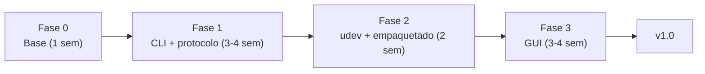

# Plan estratégico: x56linux 1.0

## 0. Verificación en tu máquina (confirma la auditoría)

Ejecuté comprobaciones de solo lectura sobre tu sistema y el repo ([`/home/angel/Develop/x56linux`](file:///home/angel/Develop/x56linux)):

| Hecho observado | Implicación |
|---|---|
| Throttle `0738:a221` y Stick `0738:2221` conectados | Tienes hardware para validar cada fase |
| El kernel ya crea **dos nodos hidraw por dispositivo**: `hidraw20/22` → interfaz `1.0` (input) y `hidraw21/23` → interfaz `1.2` (vendor `0xFF00`) | **Interface 2 ya es accesible por hidraw sin detach ni claim.** Es la base de toda la migración |
| `/dev/hidraw20..23` son `crw------- root root` | Confirma el bug 6: sin udev, solo root puede usarlos |
| No hay regla udev específica de X56 (solo `70-joystick.rules` y `70-uaccess.rules` genéricas) | Hay que entregar `70-x56.rules` |
| El repo son ~1.4k líneas: `usb.cpp` (292), `options.cpp` (272), `main.cpp` (105) + `doc/Packets.md` | Base de código pequeña: reescribir es barato; lo valioso es el **protocolo**, no el código |

> [!IMPORTANT]
> El activo real del proyecto es [`doc/Packets.md`](file:///home/angel/Develop/x56linux/doc/Packets.md). Toda la estrategia gira en torno a convertirlo en una **especificación ejecutable con tests**, independiente del lenguaje.

Inconsistencias detectadas en `Packets.md` que hay que resolver en la Fase 1:
- Packet 3: lista `curvature` en bytes 15-16 y `deadband` en 13-14 (orden invertido respecto al resto de la lista).
- Packet 6 dice curvatura `0 a 100`; packets 3 y 8 dicen `0 a 1000`.
- Packets 1/2 ("unknown") y packet 4 ("end of config?") sin semántica confirmada.
- Datos del Throttle y botones/hat del Stick: `todo`.
- Orden de bytes (endianness) y byte 0 = *Report ID* no están explícitos. Importante para hidapi.

---

## 1. Comparativa de alternativas

| Criterio | **A. C++20/23 + CMake + hidapi** | **B. Rust (hidapi/rusb, clap, zerocopy, GUI)** | **C. Python (hidapi, typer, PySide6)** |
|---|---|---|---|
| Continuidad con código actual | Alta (pero se reescribe ~80 %) | Ninguna | Ninguna |
| Seguridad de memoria (bugs 1, 5) | Mitigable con RAII/`std::span`, pero depende de disciplina | **Garantizada por el compilador** | Garantizada (runtime) |
| Parseo de paquetes binarios | `struct` packed + `static_assert`, manual | `zerocopy`/`deku`: layout verificado en compilación | `struct`/`construct`, sin verificación estática |
| CLI | CLI11 / cxxopts | **clap** (derive, completions bash/zsh/fish, man pages) | typer (muy cómodo) |
| GUI con curvas y color | Qt6 (pesado, CMake complejo) | **egui / iced / Slint** (nativo, ligero) o Tauri | **PySide6** (el más rápido de prototipar) |
| Distribución | Binario nativo; Qt aumenta tamaño | **Binario estático único**, Flatpak sencillo | Runtime + PySide6 ≈ 150–250 MB en Flatpak/AppImage |
| Testing del protocolo | GoogleTest, más fricción | `cargo test` integrado, *proptest* para round-trips | pytest, excelente |
| Barrera de contribución (comunidad de simuladores) | Media | Media-alta | **Baja** |
| Riesgo de abandono por mantenimiento | Medio (toolchains/Qt) | Bajo (`cargo` reproducible) | Medio (dependencias Qt/wheels) |
| Esfuerzo hasta 1.0 | ~8–10 sem | ~8–10 sem | ~5–7 sem |

### Recomendación: **Opción B (Rust)**, con un núcleo de protocolo sin E/S

Razones:
1. **El dominio es "bytes en, bytes fuera"**: paquetes de tamaño fijo con rangos validados (0–1000, IDs de eje). Rust modela esto con tipos (`Axis`, `Permille(u16)`, `Profile`) de forma que los estados inválidos no compilan. Los bugs 1, 2 y 4 de la auditoría (overflow de 63/64, `wIndex`, orden de release) son *clases de error* que desaparecen.
2. **Un solo binario** facilita Flatpak/AppImage y el `--install-udev`.
3. **CLI y GUI comparten el mismo crate** (no hay que duplicar protocolo, a diferencia de CLI C++ + GUI Python).
4. El proyecto está abandonado: lo que lo mantiene vivo es que sea **barato de mantener**. `cargo` + tests + CI reproducible lo logra mejor que Qt/CMake.

Arquitectura propuesta (workspace Cargo):

```text
x56linux/
├─ crates/
│  ├─ x56-proto/   # no_std-friendly, SIN E/S: encode/decode de packets 1-8, tipos, validación
│  ├─ x56-hid/     # backend hidraw (trait Transport + impl hidapi/hidraw + MockTransport)
│  ├─ x56-core/    # casos de uso: set_rgb, read_config, set_curve, calibrate_hall
│  ├─ x56-cli/     # clap
│  └─ x56-gui/     # egui o Slint
├─ packaging/      # udev, flatpak, appimage, .desktop, metainfo
├─ doc/            # Packets.md → protocolo versionado + fixtures de capturas
└─ tests/          # golden files de capturas reales
```

> [!TIP]
> **Estrategia de bajo riesgo:** usa un script Python de ~100 líneas como "laboratorio" (hidraw + `hid`) para validar las dudas del protocolo (packets 1/2/4, throttle) en tu hardware **antes** de fijar los tipos en Rust. No es una opción de producto, solo una herramienta de ingeniería inversa.
>
> **Cuándo elegir otra opción:** si quieres un resultado en 3–4 semanas y no te importa el peso de distribución → C. Si el objetivo es mantener el código existente → A. Mi recomendación depende de que estés dispuesto a trabajar en Rust; dímelo si no.

---

## 2. Por qué migrar de libusb raw a hidapi/hidraw

Interface 0 e Interface 2 son clase **HID**. El kernel ya los gestiona con `usbhid`/`hid-generic` y los expone como `/dev/hidrawN`. Usar libusb es saltarse una capa que ya funciona.

| Aspecto | libusb raw (actual) | hidraw / hidapi (backend hidraw) |
|---|---|---|
| **Permisos** | Acceso a `/dev/bus/usb/BBB/DDD` (todo el dispositivo, todas las interfaces) → root o regla udev amplia | Acceso solo al nodo `/dev/hidrawN` de **la interfaz 2** → regla udev mínima con `uaccess` |
| **Detach del kernel** | Hay que `detach_kernel_driver` + `claim_interface`. Con Interface 0 desconecta el joystick (bug 3) | **No hay detach ni claim**: coexisten con `usbhid`. El joystick sigue funcionando en el simulador mientras configuras |
| **Estabilidad** | `wIndex`, tamaños y orden de release son manuales (bugs 1, 2, 4). Si la app muere, el dispositivo puede quedar sin driver | El kernel arma el `SET_REPORT`/`GET_REPORT` (wValue, wIndex, longitud) a partir del *Report ID*. El cierre del fd lo limpia el kernel |
| **Reconexión / hotplug** | Manual | Nodos se recrean; se detecta por `udev` (`hid_enumerate`) |
| **Lectura de interrupt EP2** (respuesta packet 8) | `libusb_interrupt_transfer` con timeouts | `read()` sobre hidraw (con timeout/`poll`) |
| **Portabilidad** | Linux/Win/Mac | Idem, API única |

Detalles de implementación importantes:
- **Elegir el backend `hidraw` de hidapi, no el `libusb`**. El backend libusb de hidapi **también hace detach** del driver del kernel.
- Mapeo de operaciones:
  - Packets "feature set" → `hid_send_feature_report()` (**el primer byte es el Report ID**: `0x0b`, `0x09`, `0x01`).
  - Packet 6 "feature request" → `hid_get_feature_report()`.
  - Packet 8 "interrupt in" → `hid_read_timeout()`.
- **Identificar la interfaz correcta** con `interface_number == 2` (o `usage_page == 0xFF00`), no con el índice del nodo. El nodo hidraw varía entre arranques.
- **Fallback (no por defecto):** mantener un backend `rusb` detrás del `trait Transport` solo si algún firmware no expone la interfaz 2 por hidraw. Solo en `--backend usb`, **nunca** haciendo detach de la Interface 0.
- Calibración: el muestreo de posición (X/Y) se puede leer **de solo lectura** desde el hidraw de la interfaz 0 (o evdev) sin interferir con el kernel.

---

## 3. Soporte de hardware: Saitek (azul) y Logitech G X56 (gris/negro)

**Qué cambia:**
1. **Tabla de dispositivos, no constantes.**

   | Modelo | Rol | VID:PID | Estado |
   |---|---|---|---|
   | Saitek/Mad Catz Pro Flight X-56 Rhino | Stick | `0738:2221` | Verificado (tu equipo) |
   | Saitek/Mad Catz Pro Flight X-56 Rhino | Throttle | `0738:a221` | Verificado (tu equipo) |
   | Logitech G X56 RGB | Stick | `046d:c22b` | **Por verificar** con `lsusb -v` de un usuario |
   | Logitech G X56 RGB | Throttle | `046d:c22a` | **Por verificar** |

   Estos PIDs Logitech provienen de mi conocimiento y no los pude confirmar en esta máquina. Se validan con `lsusb -v` y con un script `x56 dump-descriptors` que los usuarios pegarán en un issue.
2. **Descriptores HID y capacidades por modelo** (`struct DeviceProfile { vid, pid, kind, axes, has_rgb, report_ids, ... }`). No asumir que los *Report IDs*, los IDs de eje (30/31/35, 32/36/37) o el protocolo RGB son idénticos. Los modelos Logitech añadieron RGB más rico (modos/zonas), y el Saitek original solo tiene color de luz.
3. **Detección de capacidades en runtime**: leer el *report descriptor* (`hid_get_report_descriptor`) y comparar con el esperado; si no coincide, modo `--unsafe-experimental` con aviso.
4. **Fixtures de captura por modelo** (`usbmon`/Wireshark) en `tests/fixtures/{saitek,logitech}/`, con tests de round-trip.
5. **Nombrado**: unificar la CLI como `x56 --device stick|throttle [--serial N]`; soportar varios dispositivos con selección por número de serie (`hid_enumerate`).
6. **Programa comunitario**: plantilla de issue "Mi X56 no es reconocido" con `lsusb -v`, `udevadm info`, descriptor HID.

> [!WARNING]
> Todo comando que escriba al dispositivo en un modelo no verificado debe pedir `--yes-i-know` y hacer antes un **backup** de la configuración leída (packets 7/8). La calibración puede dejar el dispositivo con ejes mal centrados.

---

## 4. Especificación udev (sin sudo/root)

Archivo: `/usr/lib/udev/rules.d/70-x56.rules` (paquetes) o `/etc/udev/rules.d/70-x56.rules` (instalación manual). Debe ir **antes de `73-seat-late.rules`**, que es donde `uaccess` se aplica; `70-` cumple.

```udev
# x56linux - acceso sin root a Saitek/Mad Catz Pro Flight X-56 Rhino y Logitech G X56
ACTION=="remove", GOTO="x56_end"

# --- hidraw (interfaz 2 vendor 0xFF00 y interfaz 0 input): ruta principal ---
KERNEL=="hidraw*", SUBSYSTEM=="hidraw", \
  ATTRS{idVendor}=="0738", ATTRS{idProduct}=="2221|a221", \
  TAG+="uaccess", GROUP="input", MODE="0660"

KERNEL=="hidraw*", SUBSYSTEM=="hidraw", \
  ATTRS{idVendor}=="046d", ATTRS{idProduct}=="c22a|c22b", \
  TAG+="uaccess", GROUP="input", MODE="0660"

# --- fallback libusb (solo si se usa --backend usb) ---
SUBSYSTEM=="usb", ENV{DEVTYPE}=="usb_device", \
  ATTR{idVendor}=="0738", ATTR{idProduct}=="2221|a221", \
  TAG+="uaccess"
SUBSYSTEM=="usb", ENV{DEVTYPE}=="usb_device", \
  ATTR{idVendor}=="046d", ATTR{idProduct}=="c22a|c22b", \
  TAG+="uaccess"

LABEL="x56_end"
```

Decisiones de diseño:
- **`TAG+="uaccess"`** da ACL al usuario con sesión activa (no hace falta ser parte de ningún grupo). Es la vía moderna recomendada.
- **`GROUP="input", MODE="0660"`** es la red de seguridad para sesiones sin `logind` (SSH, headless, contenedores).
- **Alcance mínimo**: solo VID:PID concretos, nunca `MODE="0666"` ni reglas por clase HID.
- Un solo archivo para ambas marcas; la lista de PIDs se genera desde la tabla de `DeviceProfile` para que no diverjan (`build.rs` / `xtask gen-udev`).

Instalación y validación:
```bash
sudo install -m 0644 packaging/70-x56.rules /etc/udev/rules.d/
sudo udevadm control --reload-rules
sudo udevadm trigger --subsystem-match=hidraw --action=add   # o reconectar el dispositivo

udevadm test /sys/class/hidraw/hidraw21 2>&1 | grep -iE 'uaccess|GROUP|MODE'
getfacl /dev/hidraw21          # debe mostrar user:<tu_usuario>:rw-
x56 list                       # sin sudo
```

Extras:
- Comando `x56 doctor`: detecta si la regla está instalada, si los nodos son accesibles y sugiere el comando exacto. Opción `x56 install-udev` vía `pkexec` (para AppImage).
- Un `uaccess` solo aplica a la sesión de usuario en el asiento activo; documentarlo.

---

## 5. Roadmap hacia 1.0



### Fase 0 — Cimientos (≈1 semana)
- [ ] Migrar repo: workspace Cargo, CI (GitHub Actions: `fmt`, `clippy`, `test`, build), reemplazar `.travis.yml`/Makefile.
- [ ] Dejar el código C++ en una rama `legacy/` (archivo de referencia) y archivar los 6 bugs como issues cerrados "no aplica en reescritura".
- [ ] Crear `x56-proto` con los packets 1–8 y **tests unitarios contra los bytes de `Packets.md`**.
- [ ] Script de laboratorio hidraw para verificar dudas del protocolo (packets 1/2/4, endianness, Report ID) en tu hardware.

### Fase 1 — CLI funcional y corrección de protocolo (≈3–4 semanas)
| Hito | Entregable | Criterio de aceptación |
|---|---|---|
| 1.1 Transporte | `trait Transport`, impl hidraw, `MockTransport`, localización de la interfaz 2 por `usage_page 0xFF00` | `x56 list` muestra stick y throttle sin detach; el joystick sigue respondiendo en `jstest` |
| 1.2 RGB | `x56 rgb --device stick --color #ff8800` (packet 5 + packet 4) | LED cambia en hardware; validación de rango en el tipo |
| 1.3 Lectura de config | Packets 7/8 (interrupt) y 6 (feature) para **todos los ejes**; `x56 get [--json]` | Valores coinciden con lo escrito; resuelve discrepancias 0-100 vs 0-1000 |
| 1.4 Curvas, saturación, deadband | `x56 axis set --axis x --curve 500 --deadband 20 --xsat 1000 --ysat 1000 --profile s\|j` (packets 1–4) | Escribe y relee (round-trip) con éxito; efecto medido con `evtest` |
| 1.5 Calibración Hall | `x56 calibrate stick`: resetear a cero (pasos 1–4), muestreo/promedio de X/Y (N muestras, leído de la interfaz 0), escritura de bytes 18–19 (pasos 5–8) | Stick centrado queda en 0x8000±tolerancia; incluye `--dry-run` y backup previo |
| 1.6 Perfiles | `x56 profile save/load <archivo.toml>` + `x56 reset-defaults` | Un perfil exportado se reaplica idéntico |
| 1.7 Calidad | Tests round-trip (`proptest`), fixtures de `usbmon`, manpage y completions | Cobertura del crate `x56-proto` > 90 % |

Principios transversales:
- Orden de *cleanup* con RAII (`Drop`): cerrar fd, nunca dejar el dispositivo a medias.
- Todos los comandos que escriben admiten `--dry-run` (imprime los bytes) y emiten un **backup** automático.
- Si `Packets.md` cambia, cambia un test; un cambio de bytes sin test no pasa CI.

### Fase 2 — udev, empaquetado e integración (≈2 semanas)
- [ ] `70-x56.rules` generado desde la tabla de dispositivos + test CI (`udevadm verify`).
- [ ] `x56 doctor` / `x56 install-udev` (pkexec).
- [ ] **Paquetes nativos:** `.deb`/`.rpm` (`cargo-deb`/`cargo-generate-rpm`) e instalación de la regla en `/usr/lib/udev/rules.d`; AUR (`x56linux-git`).
- [ ] **Flatpak** (manifiesto + `metainfo.xml` + `.desktop` + icono). Flatpak no ofrece un portal HID granular, por lo que necesitará `--device=all` para acceder a hidraw. **Esto puede dificultar la aceptación en Flathub**; documentar la justificación. La regla udev debe instalarse en el host (un Flatpak no puede hacerlo).
- [ ] **AppImage**: no puede instalar udev por sí mismo → `x56 install-udev` con pkexec o instrucciones.
- [ ] Integración: autocompletado bash/zsh/fish, manpages, `.desktop`, release automatizada por tags con binarios.
- [ ] Servicio opcional `x56 apply-profile` mediante `systemd --user` o regla `udev` con `TAG+="systemd"` para **reaplicar el perfil al conectar** el dispositivo (los ajustes pueden no ser persistentes tras desconectar; confirmar en hardware).

### Fase 3 — GUI interactiva (≈3–4 semanas)
- Framework: **egui** (rápido de iterar y buen *plotting* con `egui_plot`) o **Slint** (más pulido, licencia a revisar). Reusa `x56-core` sin cambios.
- [ ] Pantalla principal: detección de dispositivos, hotplug, estado de permisos (usa `doctor`).
- [ ] **Editor de curvas**: gráfico en vivo, arrastrar para modificar curvatura/deadband/saturación; perfil S/J; comparación entrada→salida con la posición real del eje superpuesta (lectura en vivo de la interfaz 0).
- [ ] **RGB**: selector de color con previsualización inmediata y presets.
- [ ] **Asistente de calibración Hall**: guiado paso a paso ("suelta el stick") con barra de progreso y verificación.
- [ ] Perfiles: importar/exportar, "aplicar al conectar".
- [ ] Accesibilidad básica (teclado, contraste), i18n (es/en).
- [ ] Beta pública → recoger reportes de **Logitech G X56** para completar la tabla de PIDs → **v1.0**.

### Definición de "v1.0 hecha"
1. Funciona sin root en Debian/Ubuntu, Fedora, Arch (CI en contenedores + prueba manual).
2. No desconecta el joystick durante el uso (verificable con `jstest` activo).
3. Cubre RGB, lectura/escritura de config, curvas, saturación, deadband, calibración Hall en ambos dispositivos.
4. Packets 1–8 documentados sin discrepancias y cubiertos por tests.
5. GUI con editor de curvas y previsualización RGB.
6. Binarios publicados (deb/rpm/AppImage/Flatpak) y regla udev instalable.

---

## 6. Riesgos y mitigaciones

| Riesgo | Mitigación |
|---|---|
| Protocolo ~90 %: packets 1/2/4 y throttle sin confirmar | Fase 0 con laboratorio hidraw + capturas `usbmon`; marcar campos inciertos como `experimental` |
| Calibración mal escrita deja ejes descentrados | Backup, `--dry-run`, `reset-defaults`, confirmación explícita |
| No hay hardware Logitech para probar | Soporte "best effort" con aviso, plantilla de issue, fixtures aportadas por la comunidad |
| Flathub rechaza `--device=all` | Distribuir también deb/rpm/AppImage; documentar la justificación |
| Mantenedor único / abandono | CI estricta, tests de protocolo, documentación de contribución, `CONTRIBUTING.md` |
| Licencia: el repo es GPL | Mantener GPL-compatible en todas las dependencias (egui/hidapi/clap son MIT/Apache) |

## 7. Siguiente paso concreto

Empezar por la **Fase 0**: crear el workspace y `x56-proto`, y ejecutar el laboratorio hidraw sobre `hidraw21` (throttle, interfaz 2) y `hidraw23` (stick, interfaz 2); el número puede cambiar entre arranques tras instalar la regla udev. Esto desbloquea todo lo demás.
